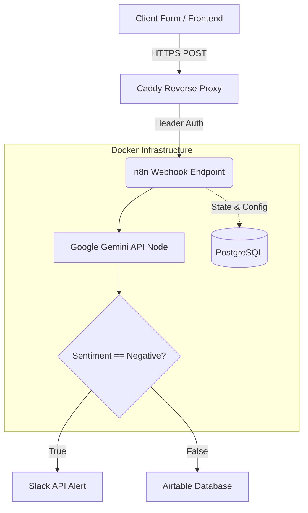

# Automated AI Ticketing System

## Project Overview

The Automated AI Ticketing System is a self-hosted, event-driven automation pipeline built to categorize, process, and route customer inquiries using Artificial Intelligence. This project demonstrates backend automation, infrastructure containerization, and secure API integrations.

The primary objective of this system is to reduce the manual workload of customer support teams by instantly analyzing the sentiment and context of incoming requests. Critical issues are immediately routed to a designated alerting channel, while standard inquiries are logged into a persistent database for regular processing.

## Architecture

The system is deployed using Docker, ensuring portability and isolated execution. The core automation engine is n8n, backed by a PostgreSQL database for persistent state management. A Reverse Proxy (Caddy) is designed to handle SSL termination and route external webhook traffic securely.



## Security & Reliability Measures

1. **Endpoint Protection (Header Auth)**: The public-facing Webhook is secured using HTTP Header Authentication (`X-API-Key`). Any request lacking the correct cryptographic token is dropped immediately with a `401 Unauthorized` response, preventing DDoS attacks and unauthorized consumption of AI API quotas.
2. **Persistent Storage**: Default SQLite storage was replaced with a dedicated PostgreSQL container to ensure horizontal scalability, prevent database locks during high concurrency, and secure workflow states.
3. **Fault Tolerance**: The architecture supports automatic retry mechanisms and gracefully handles 503 Service Unavailable errors from external AI providers.

## Technology Stack

- **Automation Engine**: n8n (Node-based workflow automation)
- **Containerization**: Docker & Docker Compose
- **Database**: PostgreSQL 16
- **Artificial Intelligence**: Google Gemini API (gemini-3.5-flash)
- **Integrations**: Slack API, REST HTTP Requests

## Setup & Installation

1. Clone the repository.
2. Ensure Docker Desktop or Docker Engine is installed.
3. Review and adjust environment variables in the `.env` file (Database credentials, n8n Basic Auth).
4. Start the infrastructure:
   ```bash
   docker-compose up -d
   ```
5. Access the n8n interface at `http://localhost:5678`.
6. Import the `workflow_template.json` file.
7. Configure the `Header Auth` credential in the Webhook node and provide the Google Gemini API key.
